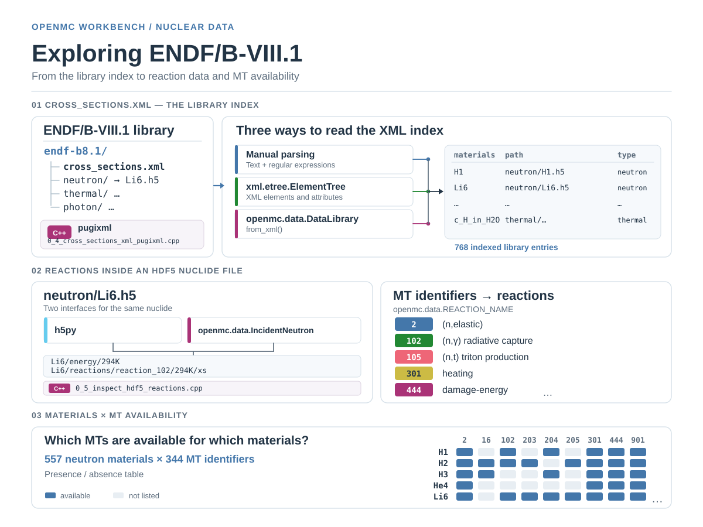

# Nuclear data

## Beware of file-size explosion
Nuclear-data libraries can take up a substantial amount of disk space after downloading and conversion. Here is what I have:

| Library or data | Installed disk space |
| --- | ---: |
| ENDF/B-VIII.1 | 43 GiB |
| JEFF-4.0 | 51 GiB |
| JENDL-5 | 31 GiB |
| FENDL-3.2c | 907 MiB |
| WMP v1.1 | 16 MiB |
| Depletion chains | 123 MiB |

That adds up to roughly 126 GiB. Before downloading or converting anything, set `APPLY = False` in the setup notebook or Python script to preview the installation.

Two alternative formats are provided:

- **`0_0_set_up_nuclear_data.ipynb`** — The primary, documented Jupyter notebook, allowing users to inspect and execute the setup step by step.
- **`0_0_set_up_nuclear_data.py`** — A standalone Python script exported from the notebook for command-line execution.

The two are alternatives, not sequential steps. Run either one; not both.

A shell (`.sh`) version is not provided because the setup relies substantially on Python libraries, including OpenMC. Reimplementing it in shell would introduce unnecessary duplication.

  

**→** [0_1_explore_endf_b81.ipynb](0_1_explore_endf_b81.ipynb) 