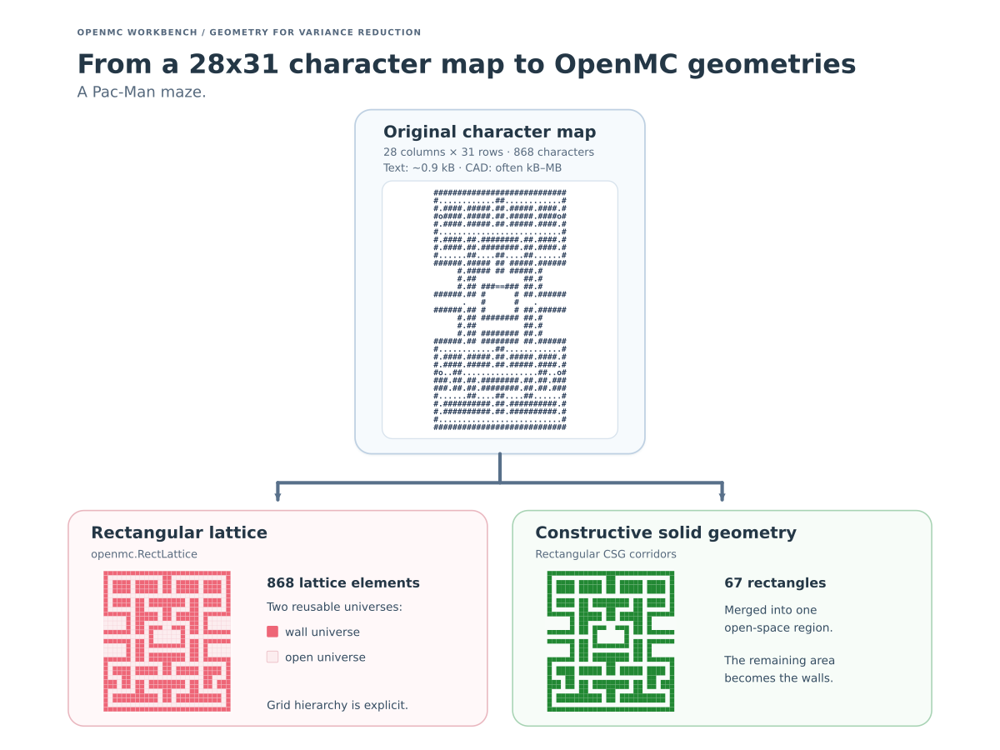

# Geometry

  

The elegance is in the simplicity: no CAD, just a 28 × 31 character map — 868 ASCII bytes of layout data, or about 0.9 kB as a text file with line breaks. Conventional CAD files often occupy kilobytes to megabytes, depending on format and detail; this is an illustrative contrast, not a measured comparison with an equivalent CAD model.

The character map is adapted from [Pac-Man Parameterized](https://github.com/philpilkington/pacman-parameterized-html/blob/main/pacman-parameterized.html#L160-L196), a text-based reconstruction of the original arcade maze. From that, [the notebook](3_0_ways_to_build_pacman_maze.ipynb) constructs the same physical volume in two ways: a `RectLattice` built from two reusable tile universes, and a CSG geometry built from merged rectangular corridors. It is an opportunity to showcase OpenMC's lattice capability as much as to provide a geometry for exploring air streaming, shielding, and variance reduction.

The geometry is easy to rescale. In the example, `TILE_CM = 100.0` sets the width of each tile, including the narrowest walls. Increasing it makes the walls *and corridors* wider together; `MAZE_Z_HALF_CM` and `SLAB_CM` independently control the maze's axial thickness and the end slabs. A change to a parameter or two adapts the maze to different transport conditions, including investigations at higher energies, without redrawing it.

**→** [3_0_ways_to_build_pacman_maze.ipynb](3_0_ways_to_build_pacman_maze.ipynb) 