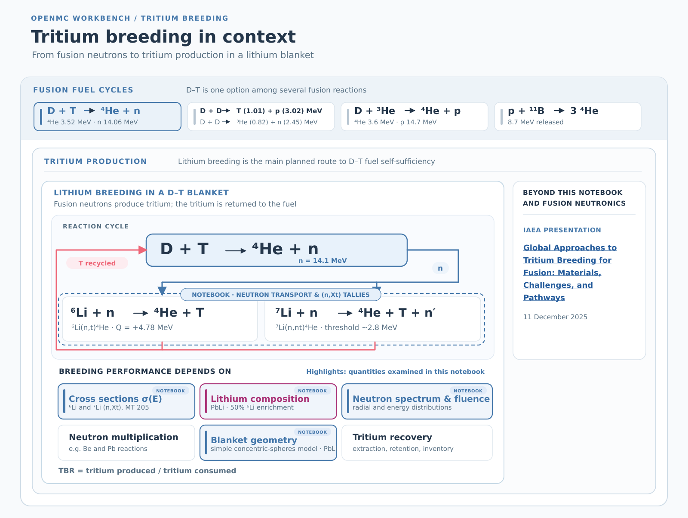

# Tritium breeding: where the neutrons go

We move to our first neutron-transport simulation. Tritium breeding provides a practical example, starting with a simple spherical model.

A D–T fusion reaction releases a neutron of about 14.1 MeV. As neutrons pass through a breeding blanket, reactions with ⁶Li and ⁷Li can produce tritium for the D–T fuel cycle. The yield depends not only on lithium cross sections and composition, but also on how neutrons interact with the surrounding nuclei, lose energy, and escape.

**→** [`4_0_breeder_tritium_neutron_maps.ipynb`](4_0_breeder_tritium_neutron_maps.ipynb)