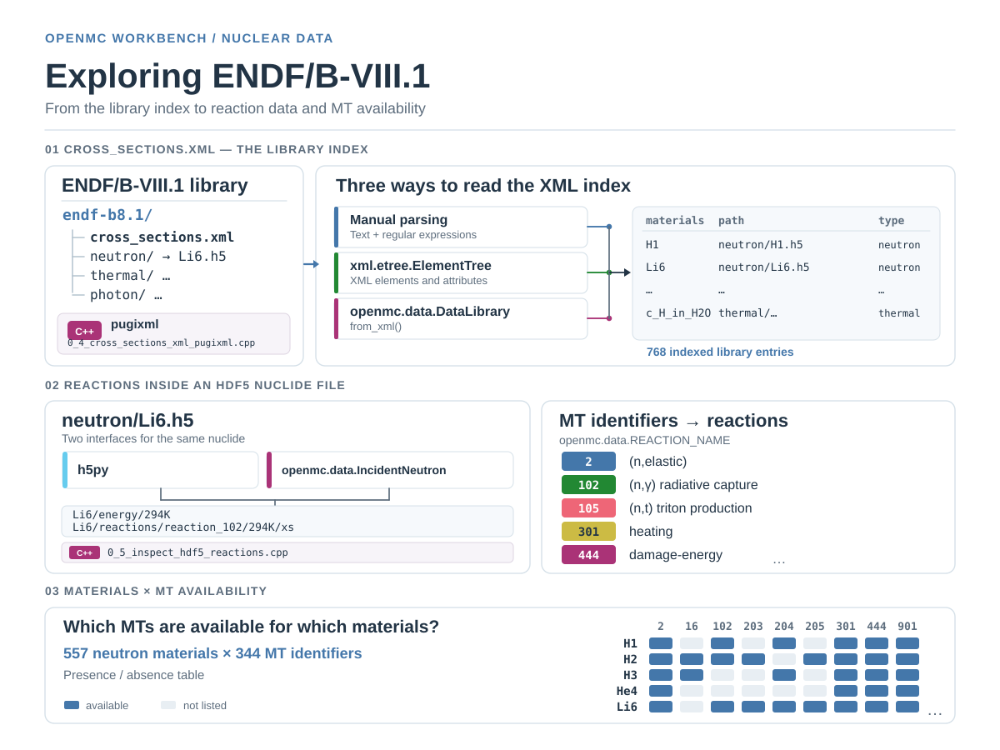
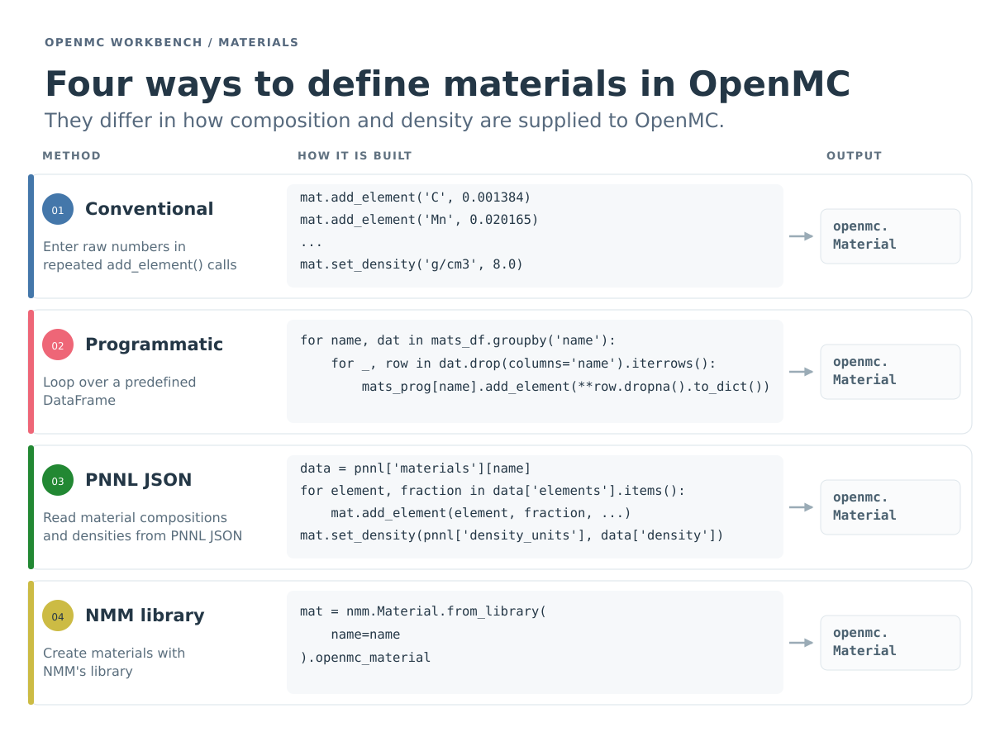
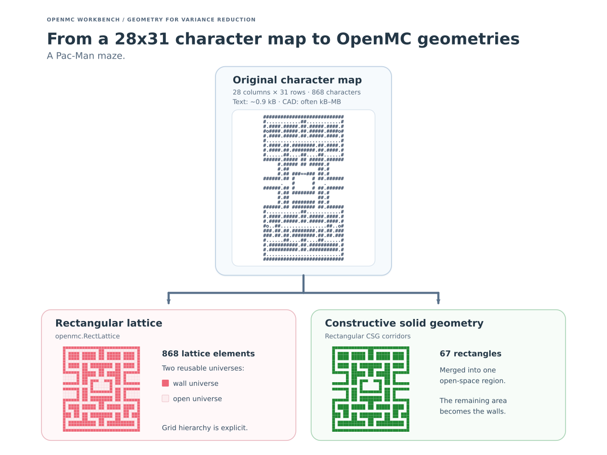
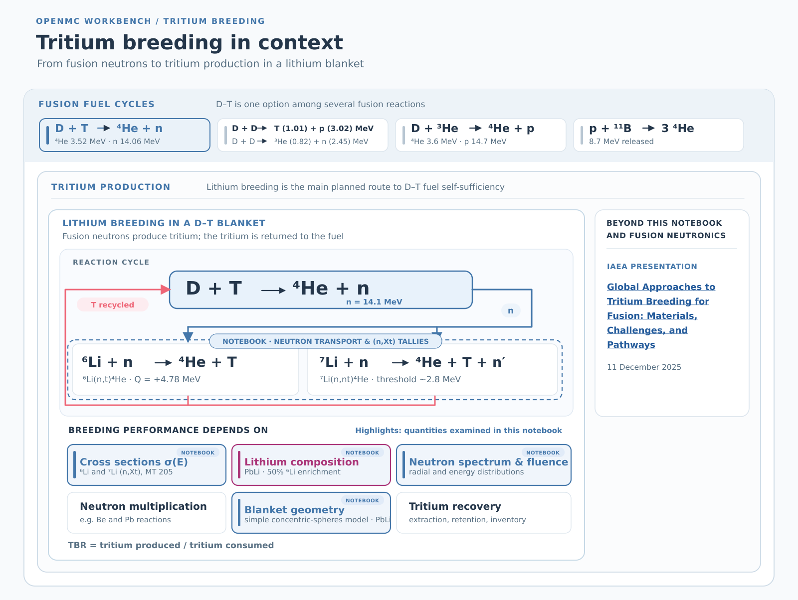
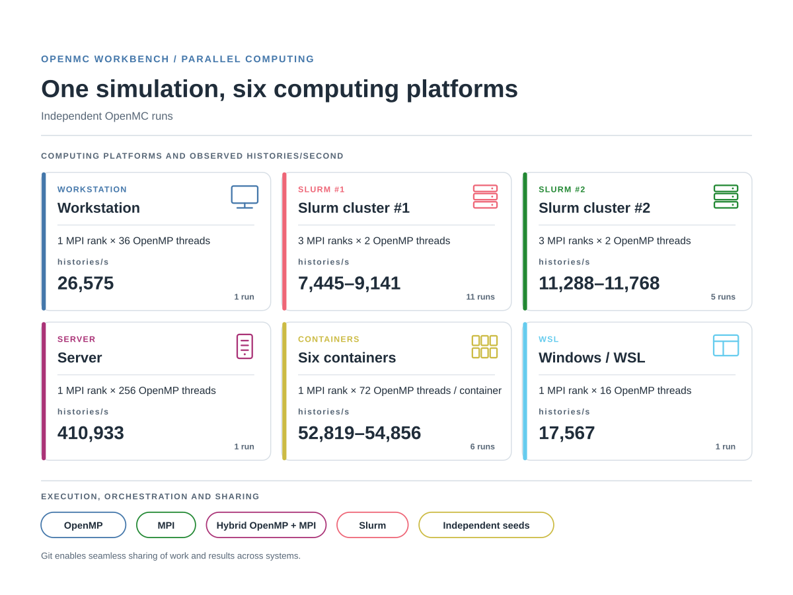
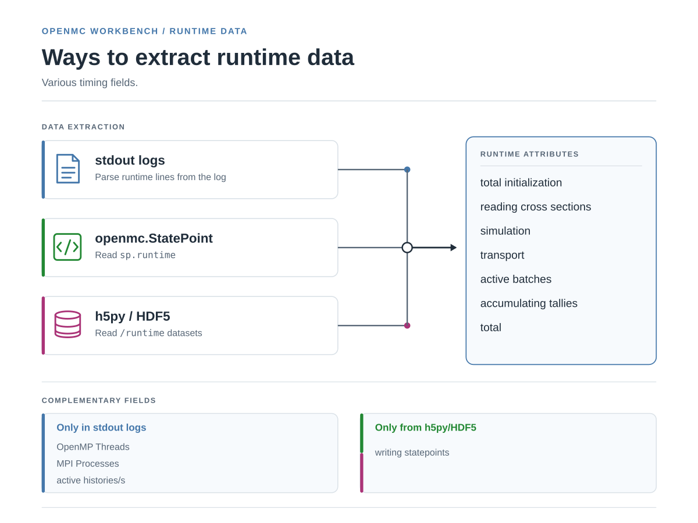

# OpenMC Workbench

<p>

</p>

[](https://github.com/marypwchin/openmc-workbench/actions/workflows/notebooks.yml)
[](https://github.com/marypwchin/openmc-workbench/actions/workflows/publish.yml)
[](https://github.com/marypwchin/openmc-workbench/actions/workflows/links.yml)
[](https://marypwchin.github.io/openmc-workbench/)


<!-- shared:introduction -->

This workbench is an expression of the joy of experimentation — running simulations in the laboratory of computers. Starting from a first installation of [OpenMC](https://openmc.org/), a radiation-transport enthusiast explores.

It emphasizes hands-on investigation, computational workflows, and practical understanding.

By Mary P. W. Chin
<!-- /shared:introduction -->

The [Workbench website](https://marypwchin.github.io/openmc-workbench/) of this repository offers an alternative reading experience, with menus, on-page section navigation, and previous/next page links. The content is largely the same.

## Status

<!-- shared:status -->
This is an active and evolving workbench.

The repository is public in the spirit of open-source collaboration and scientific exchange. Alongside the Jupyter notebooks and C++ programs, it documents what goes on behind the scenes — data preparation, configuration, and computational environment — for transparency and reproducibility.

Rather than a polished end-user tutorial, the workbench is a record of ongoing exploration. Comments, corrections, and peer review are welcome.
<!-- /shared:status -->

## The workbench at a glance

<!-- generated:structure -->
<p>
  <a href="0_nuclear_data/README.md"></a>
  <a href="2_materials/README.md"></a>
  <a href="3_geometry/README.md"></a>
  <a href="4_run/README.md"></a>
  <a href="5_MPI_OpenMP_Slurm/README.md"></a>
  <a href="5_MPI_OpenMP_Slurm/README.md"></a>
</p>
<!-- /generated:structure -->

## Nuts and bolts

### Python and C++

OpenMC's transport kernel is written in C++, but much of its user-facing API is in Python. Most explorations here therefore use Python, particularly for model construction, calculations, and analysis. C++ is used selectively, where it is useful to examine data formats, underlying structures, or aspects of OpenMC's implementation more directly.

### Programmatic approach

Throughout the Workbench, I draw on practices from data science where practical. I organize nuclear data, model specifications, and simulation results in pandas DataFrames, and process them programmatically.

For instance, an OpenMC material is typically defined by calling `openmc.Material.add_element()` separately for each element, passing numerical values directly as arguments:

```python
breeder_material = openmc.Material()
breeder_material.add_element('Pb', 84.2, percent_type='ao')
breeder_material.add_element('Li', 15.8, percent_type='ao', enrichment=90., enrichment_target='Li6', enrichment_type='ao')
```

In contrast, [2_0_ways_to_define_materials.ipynb](2_materials/2_0_ways_to_define_materials.ipynb) organizes material compositions, including isotopic enrichment specifications, in a DataFrame:

```python
mats_df.loc[len(mats_df)] = ['PbLi_manual', 'Pb', 84.2, 'ao'] + 3 * [None]
mats_df.loc[len(mats_df)] = ['PbLi_manual', 'Li', 15.8, 'ao', 90., 'Li6', 'ao']
```

A common loop then constructs the OpenMC materials:

```python
mats = {}
for name, dat in mats_df.groupby('name'):
    mats[name] = openmc.Material(name=name)

    for _, row in dat.drop(columns='name').iterrows():
        mats[name].add_element(**row.dropna().to_dict())
```

This separation of input data from model-construction logic minimizes repetitive code, reduces the risk of inconsistencies, and makes the examples easier to explore, modify, and validate.

### Plotting style

The Workbench uses a common Matplotlib style, [`workbench.mplstyle`](workbench.mplstyle), for consistent typography, colors, markers, and plot formatting.

The color choices follow [Matplotlib's guidance on colormaps](https://matplotlib.org/stable/users/explain/colors/colormaps.html), emphasizing perceptual uniformity and accessibility across different forms of color vision.

The default continuous colormap is `inferno_r`, a perceptually uniform sequential colormap. For categorical plots, the Workbench uses [Paul Tol Bright](https://sronpersonalpages.nl/~pault/), a color-blind-safe qualitative palette, complemented by distinct markers to improve readability.

For comparisons relative to a reference value, the Workbench uses the diverging colormap `RdBu`. This is useful, for example, when plotting FOM ratios between variance-reduction techniques, where unity represents parity. A logarithmic scale places unity at the center, treating reciprocal ratios symmetrically.

Load the style in a notebook with:

```python
from pathlib import Path
import matplotlib.pyplot as plt
import openmc_workbench_config

plt.style.use(Path(openmc_workbench_config.__file__).with_name('workbench.mplstyle'))
```

## Nuclear-data paths

<!-- shared:data -->
Scripts can break when files are not found at their expected locations. To minimize this problem, OpenMC Workbench keeps nuclear-data paths in one place, rather than requiring them to be specified in each notebook or program.

The nuclear-data libraries reside outside the repository, and the location needs to be specified only once.

### Optional: Install nuclear-data libraries

If you already have the required nuclear-data libraries, you can skip their installation.

Otherwise, see [0_nuclear_data/README.md](0_nuclear_data/README.md).

### Set up nuclear-data paths

From the repository root:

1. **Set the data location.** Copy `data_root.example.txt` to `data_root.txt`, then edit it to specify the path to your nuclear-data directory.

2. **Set up Python.** In the Python environment used by your Jupyter kernel, run:

   ```bash
   python -m pip install -e .
   ```

   Alternatively, run the following directly in a notebook, using the absolute path to your repository:

   ```python
   %pip install -e /absolute/path/to/openmc-workbench
   ```

3. **Set up C++.** From the repository root, run:

   ```bash
   python openmc_workbench_config.py
   ```

Step 2 makes `openmc_workbench_config` importable in Python. The notebooks can then access nuclear-data paths through statements such as:

```python
from openmc_workbench_config import ENDF_B81
```

Step 3 generates `openmc_workbench_config.hpp`, providing the same paths to C++ programs through:

```cpp
#include "openmc_workbench_config.hpp"
```

### Configuration files

| File | Purpose |
|---|---|
| `data_root.txt` | Created and edited by the user; specifies the nuclear-data directory. |
| `openmc_workbench_config.py` | Provided with the repository; discovers nuclear-data directories and makes their paths available to Python. |
| `openmc_workbench_config.hpp` | Generated by Step 3; makes the same paths available to C++. |

Library names such as `ENDF_B80`, `ENDF_B81`, and `FENDL_32C` are generated automatically from existing directory names. If new library directories are added, rerun Step 3 to update the C++ header.

This arrangement allows Python notebooks and C++ programs to use the same nuclear-data paths without maintaining separate path settings.
<!-- /shared:data -->

## Compilers and libraries

<!-- shared:compilers -->
See [docs/compilers_and_libraries.md](docs/compilers_and_libraries.md).
<!-- /shared:compilers -->

## License and citation

OpenMC Workbench is released under the [Apache License 2.0](LICENSE). You are welcome to use, modify, and build upon the work, subject to the license terms.

For academic use, please cite the Workbench using [CITATION.cff](CITATION.cff), and acknowledge the relevant original publications and data sources.