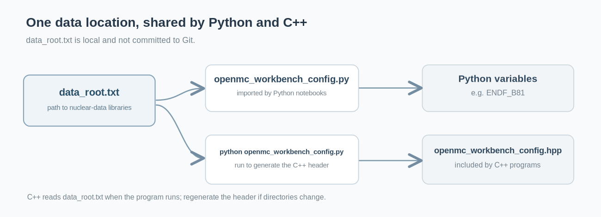
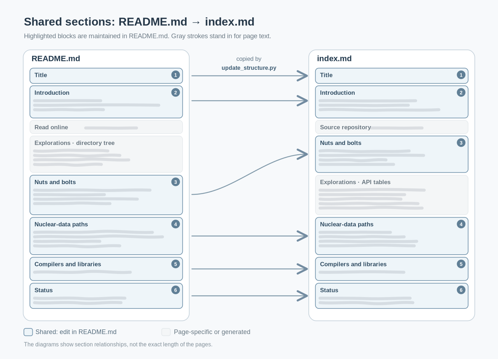
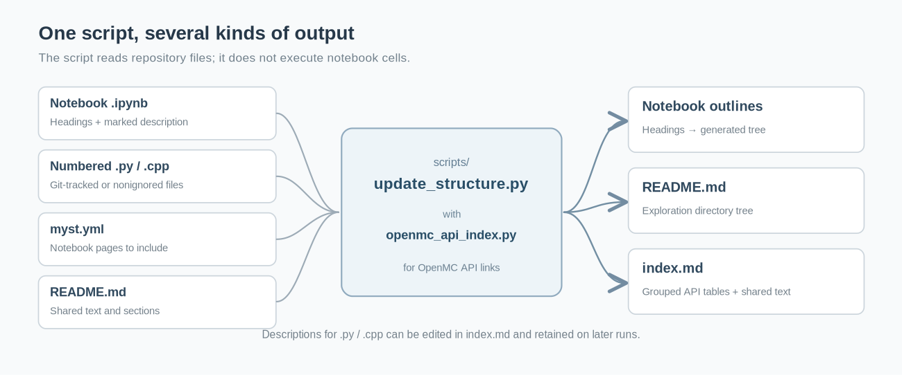
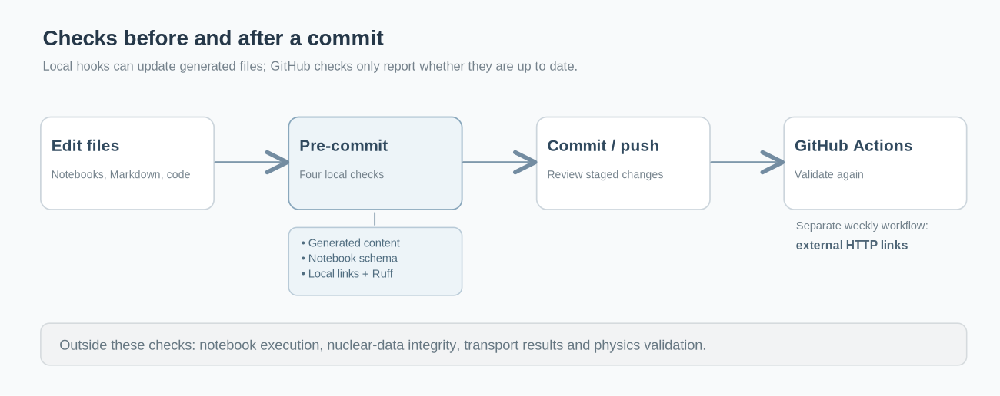

# Repository automation: step by step

OpenMC Workbench uses a few scripts to keep its documentation up to date and check files before they are committed. The checks can catch missing links, invalid notebooks, and Python errors. They do **not** run OpenMC calculations or establish that the scientific results are correct.

## Files and their purposes

These are the main files. Paths are relative to the repository root.

| File | Purpose |
| --- | --- |
| [.github/workflows/notebooks.yml](../.github/workflows/notebooks.yml) | Runs notebook and Python checks after a push, pull request, or manual start on GitHub. |
| [.github/workflows/links.yml](../.github/workflows/links.yml) | Checks external links weekly or when started manually. |
| [.pre-commit-config.yaml](../.pre-commit-config.yaml) | Specifies which checks run locally before a Git commit. |
| [requirements-dev.txt](../requirements-dev.txt) | Lists packages used to check repository files. |
| [pyproject.toml](../pyproject.toml) | Defines the installable Python module (`python -m pip install -e .`). |
| [openmc_workbench_config.py](../openmc_workbench_config.py) | Provides nuclear-data paths to Python and generates the C++ header when run as a script. |
| `data_root.txt` | User-created file pointing to the nuclear-data directory; not committed to Git. |
| [data_root.example.txt](../data_root.example.txt) | Example to copy when creating `data_root.txt`. |
| `openmc_workbench_config.hpp` | Generated C++ header; not committed to Git. |
| [scripts/update_structure.py](../scripts/update_structure.py) | Updates notebook outlines, exploration lists, and text shared by `README.md` and `index.md`. |
| [scripts/openmc_api_index.py](../scripts/openmc_api_index.py) | Identifies documented OpenMC API calls in `.ipynb` and `.py` files. |
| [scripts/check_notebooks.py](../scripts/check_notebooks.py) | Checks notebook structure without running cells. |
| [scripts/check_links.py](../scripts/check_links.py) | Checks local repository links and collects external links for online checking. |
| [.gitignore](../.gitignore) | Excludes local data paths, generated files, environments, and other unwanted files from normal Git staging. |

The GitHub workflows use YAML (`.yml`); Python packaging settings use TOML (`.toml`). These are standard file formats, even though the scripts and commands here are specific to this repository.

### Nuclear-data paths for Python and C++



The nuclear-data libraries reside outside the repository. Set their location once in `data_root.txt`, as described under [Nuclear-data paths](../README.md#nuclear-data-paths).

`openmc_workbench_config.py` is used in two ways:

- **Python:** `from openmc_workbench_config import ENDF_B81` makes the path to the existing `endf-b8.1` directory available to a notebook or script. Importing the module does not generate files.
- **C++:** Running `python openmc_workbench_config.py` from the repository root generates `openmc_workbench_config.hpp`, which a C++ program can include with `#include "openmc_workbench_config.hpp"`.

Names such as `endf-b8.1` and `fendl-3.2c` become `ENDF_B81` and `FENDL_32C`. Regenerate the header after adding, removing, or renaming library directories, or moving the repository. Changing only the nuclear-data location in `data_root.txt` does not require regeneration: C++ reads that file at run time.

## 1. Check what is generated

There are two kinds of changes to distinguish: **copying shared text** and **generating content from notebook and source files**.

### Shared text between README.md and index.md



`README.md` is the source for the **title**, **introduction**, **Nuts and bolts** subsections, **nuclear-data paths**, **compilers and libraries** link, and **status**. `scripts/update_structure.py` copies them into `index.md`, even though the two pages arrange some sections differently. Edit this shared material in `README.md`, not `index.md`.

The two **Nuts and bolts** subsections are **Python and C++** and **Programmatic approach**, including their code examples. The generator places their copies inside `generated:exploration-notes` in `index.md`.

Other parts are intentionally different: the logo, badges, and **Read online** link appear only in `README.md`; the **Source repository** link appears only in `index.md`. The exploration lists are also rendered differently, as shown below.

### Notebook outlines and exploration lists



`scripts/update_structure.py` reads Markdown headings (`#`, `##`, `###`, and so on) from each notebook and builds the outline near its beginning. Headings in fenced code examples are ignored. Use one `#` title per notebook and `##` or `###` for sections; underlined and HTML headings are not supported.

The same script produces two views of the numbered `.ipynb`, `.py`, and `.cpp` explorations:

| Page | What it shows |
| --- | --- |
| `README.md` | **Explorations** first, as a directory tree; **Nuts and bolts** follows. |
| `index.md` | **Nuts and bolts** first, then **Explorations**, grouped by numbered subdirectory. The tables contain **File**, **What it covers**, and **OpenMC API** columns. |

Notebook descriptions come from the marked description in each notebook's first Markdown title cell. Descriptions of `.py` and `.cpp` files can be edited in the `index.md` tables and are kept on later runs. New source files initially show `Description to be added.`

`scripts/openmc_api_index.py` recognizes selected OpenMC constructors, functions, and methods in Python notebooks and scripts without executing them. It supplies documentation links for the **OpenMC API** column; a dash means no recognized call was found. It does not inspect C++ code or infer every call on dynamically constructed objects.

Notebook links in `index.md` open MyST pages; `.py` and `.cpp` links open GitHub. Published notebooks are selected using `myst.yml`. The file listing includes files tracked by Git and new files that are not ignored. Empty directories, checkpoints, caches, and virtual environments do not appear; keep unwanted files and large data directories in `.gitignore`.

The generator expects `generated:structure` under **Explorations** in `README.md` and `generated:exploration-notes` under **Nuts and bolts**, followed by `generated:notebooks` under **Explorations**, in `index.md`. If these headings or markers are missing or misplaced, it reports an error rather than rearranging the page. The earlier heading reorganization belongs to the separate one-off script `one_off/nuts_and_bolts_layout.py`, not to routine automation.

Only the marked notebook outline is updated. The code, outputs, execution counts, and metadata are retained, although the notebook's JSON formatting may change. If a notebook is open during an update, reload it before saving again so the refreshed outline is not overwritten.

## 2. Update exploration lists and notebook outlines

From the repository root, run the update and inspect the changes:

```sh
python3 scripts/update_structure.py
git diff --stat
git diff -- README.md index.md
python3 scripts/update_structure.py --check
```

If you have changed only `README.md` or its shared text, you can update the pages without touching notebooks:

```sh
python3 scripts/update_structure.py --pages-only
python3 scripts/update_structure.py --pages-only --check
```

`--check` reports stale files but changes nothing. A second normal run should make no further changes. The `--readme-only` option updates only `README.md`; use `--pages-only` when the two pages need to stay synchronized.

Run the script after adding, moving, or renaming explorations; changing notebook headings or descriptions; or editing shared README text. Check the descriptions of new or renamed `.py` and `.cpp` files in `index.md`.

## 3. Set up checks before committing

Use a separate local environment for checking repository files. From the repository root:

```sh
python3 -m venv .venv
source .venv/bin/activate
python -m pip install -r requirements-dev.txt -e .
pre-commit validate-config
pre-commit install
```

The hook runs before each commit and must be installed in each new clone. The first run may need internet access to install its tools. This environment does not replace the OpenMC environment used to run notebooks.

## 4. Run the checks



Run all configured checks with:

```sh
pre-commit run --all-files
```

Four checks are included:

1. **Exploration lists and outlines:** Refreshes notebook outlines, generated lists, and shared documentation.
2. **Notebook structure:** Uses `nbformat` to check notebook-file validity, without executing cells.
3. **Local links:** Checks repository file and directory links, including notebook Markdown. It does not check heading links, notebook attachments, or links in code and outputs.
4. **Python errors:** Uses Ruff (`E9,F63,F7,F82,F401`) to find syntax errors, invalid control flow, undefined names, and unused imports. It is not a full code review.

To run a particular check:

```sh
pre-commit run update-structure --all-files
pre-commit run notebook-schema --all-files
pre-commit run fatal-python-errors --all-files
pre-commit run local-links --all-files
```

The output identifies the file and, where available, the line or notebook cell. Make corrections and run the check again. Ruff reports issues without modifying code. The documentation update **can** modify files: if it does, the commit stops so you can inspect and stage the changes before committing again. The hook does not stage them for you.

## 5. Review changes before committing

These commands show what changed and what is staged for the commit:

```sh
git status --short
git diff --check
git diff
git add -A
pre-commit run --all-files
git diff --cached --check
git diff --cached --stat
git diff --cached
```

`git diff --check` looks for whitespace problems. The `--cached` commands show staged changes. Look for accidental data files, personal directory paths, unwanted notebook outputs, or unrelated edits. If a check modifies files, inspect and stage those changes before committing.

## 6. Check notebooks and results separately

The automatic checks have a deliberately limited scope. The following still need separate attention:

- **Run notebooks from beginning to end** in the intended OpenMC environment; inspect results and assertions. This catches problems such as out-of-order execution or missing dependencies. Set `data_root.txt` and install the module with `python -m pip install -e .`, as explained in the [README](../README.md#nuclear-data-paths).
- **Install nuclear data deliberately.** `0_0_set_up_nuclear_data.ipynb` and its `.py` counterpart are alternative installation routes. Check disk space and `LOCAL_ARCHIVES`, then preview with `APPLY = False`. Downloads and conversions do not belong in commit checks.
- **Choose which notebook outputs to keep.** Plots and tables can be useful to readers; checks do not delete them.
- **Check XML and HDF5 contents.** Notebook-structure checks do not verify XML indexes, referenced files, or nuclear-data contents. There is currently no separate test suite for these.
- **Apply other formatting checks if useful.** Current Ruff rules cover clear errors and unused imports, not general style.
- **Validate the physics independently.** Data provenance, modeling assumptions, transport results, and comparisons require scientific judgment; passing the checks is not proof of correctness.

## 7. Run the checks on GitHub

[`.github/workflows/notebooks.yml`](../.github/workflows/notebooks.yml) runs after pushes and pull requests, or when started manually. Under **Actions**, open **Validate notebooks** to inspect its results. Use **Run workflow** for a manual run when the workflow is available on the default branch.

On GitHub, generated content is checked with `--check` without changing it. If the report says an outline or exploration list is out of date, run `python scripts/update_structure.py` locally, review the differences, and commit them.

Two of the checks can also be run directly on your computer:

```sh
python scripts/check_notebooks.py 0_nuclear_data/*.ipynb
ruff check --select E9,F63,F7,F82,F401 .
```

GitHub also installs `openmc_workbench_config` and tests importing `DATA_ROOT` and `ENDF_B81` from outside the repository. It creates a small temporary `endf-b8.1` directory and `data_root.txt` for the test; it does not download libraries, generate or compile the C++ header, install OpenMC, run notebook cells, or carry out transport simulations.

These checks supplement local testing and scientific review. For the checking tools, see [pre-commit](https://pre-commit.com/) and [nbformat](https://nbformat.readthedocs.io/).

## 8. Check external links

[`.github/workflows/links.yml`](../.github/workflows/links.yml) checks external links on Mondays at **13:23 UTC**. It can also be run under **Actions → Check external links → Run workflow**. Scheduled workflows run from the default branch and may start later than their scheduled time.

The workflow collects HTTP and HTTPS links from Markdown and notebook Markdown cells, then sends them to Lychee. Links in code cells, outputs, and code examples are excluded, as are nuclear-data archives referenced only inside installation code.

Failed links appear in the workflow log and summary. HTTP 403 (access denied) or 429 (rate limited) may indicate that a site blocks automated checks, rather than a broken link. Try the URL in a browser before changing it. The workflow limits concurrent requests to four and retries failures, but some sites may still block them.

To collect external links locally without checking them online:

```sh
python scripts/check_links.py
python scripts/check_links.py --external-output /tmp/openmc-external-links.txt
```

For the online checker, see [Lychee](https://github.com/lycheeverse/lychee-action).
